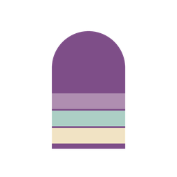
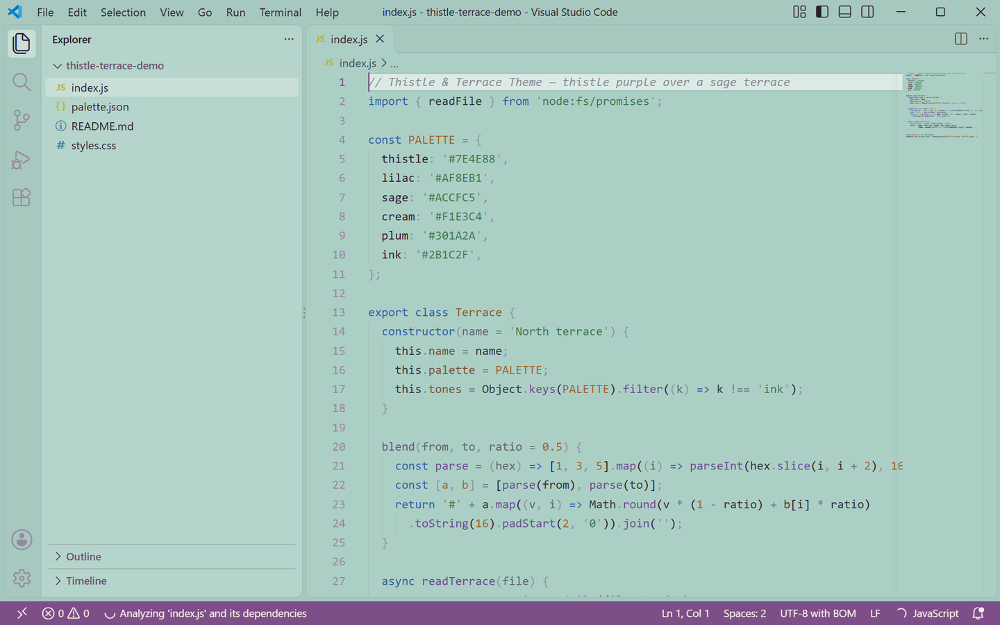
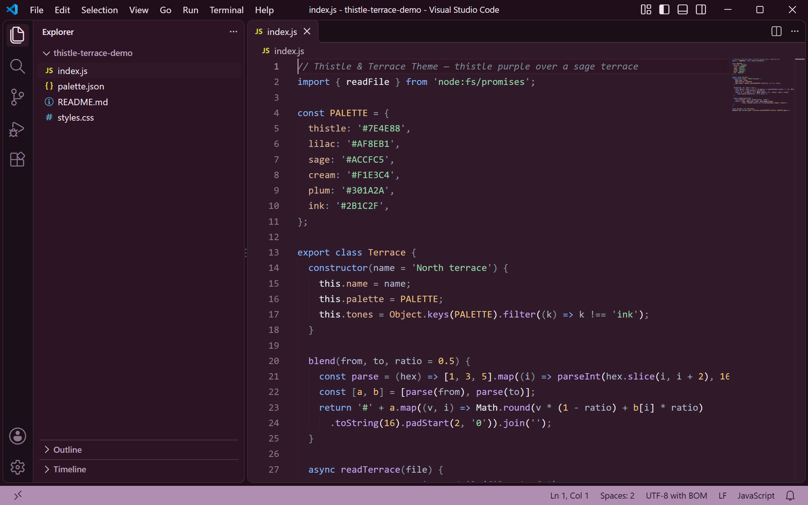

<div align="center">



# Thistle & Terrace Theme

**Thistle purple over a sage terrace — one quiet garden in a light and a dark cut.**

[](https://github.com/vaxicy/thistle-terrace-theme)
[](https://code.visualstudio.com/)
[](#two-cuts)
[](LICENSE)
[](https://github.com/vaxicy/thistle-terrace-theme)

[English](#-english) - [简体中文](#-简体中文)

</div>

---

## English

**Thistle & Terrace Theme** pairs the deep purple of a thistle with the soft sage of a
garden terrace. The light cut keeps the sage as the surface and the thistle as the accent;
the dark cut turns the whole scene into berry-plum with a lilac glow.

<a id="two-cuts"></a>

### Two cuts

| Cut | Editor | Chrome | Accent |
|---|---|---|---|
| **Light** | sage `#ACCFC5` | pale sage `#A6C8BF` | thistle `#7E4E88` |
| **Dark** | berry plum `#301A2A` | deep plum `#200F1A` | lilac `#AF8EB1` |

### Screenshots

#### Light


#### Dark


### Install

1. Open **Extensions** (`Ctrl+Shift+X`), search **Thistle & Terrace Theme**, click **Install**.
2. `Ctrl+K Ctrl+T` -> pick **Thistle & Terrace Light** or **Thistle & Terrace Dark**.

```bash
code --install-extension thistle-terrace-theme-1.0.0.vsix
```

### What's tuned

- **144 hand-placed UI colours** per cut, with matching syntax and semantic tokens.
- **De-collided surfaces.** The source card's cream `#F1E3C4` was 0.019 from wheat-clay and
  cozy-vintage, so it is never an editor background. The light editor uses the corrected sage
  `#ACCFC5` (0.098), the dark editor uses berry plum `#301A2A` (0.074). Every accent and
  chrome colour is at least 0.045 away from its nearest neighbour in the library.
- Thistle purple, lilac, sage and a single cream ribbon — four colours, two temperatures.

The full colour table lives in [`COLOR-SPEC.md`](COLOR-SPEC.md).

---

## 简体中文

**Thistle & Terrace Theme** 把蓟花的深紫与花园台地的鼠尾草绿配成一对：浅色切面用鼠尾草做
表面、蓟紫做强调；深色切面则把整个场景压成莓紫，只留淡紫微光。

### 两个切面

| 切面 | 编辑区 | 工具栏 | 强调色 |
|---|---|---|---|
| **Light** | 鼠尾草 `#ACCFC5` | 淡鼠尾草 `#A6C8BF` | 蓟紫 `#7E4E88` |
| **Dark** | 莓紫 `#301A2A` | 深梅 `#200F1A` | 淡紫 `#AF8EB1` |

### 截图

#### Light


#### Dark


### 安装

1. 在 VS Code 中打开 **扩展**（`Ctrl+Shift+X`），搜索 **Thistle & Terrace Theme** 并点击 **安装**。
2. `Ctrl+K Ctrl+T` -> 选择 **Thistle & Terrace Light** 或 **Thistle & Terrace Dark**。

```bash
code --install-extension thistle-terrace-theme-1.0.0.vsix
```

### 调校细节

- 每个切面 **144 个手工设定的 UI 颜色**，配成套的语法与语义 token。
- **底色避撞**：原卡的奶油 `#F1E3C4` 与 wheat-clay / cozy-vintage 只差 0.019，所以绝不拿来做
  编辑区底色；浅底改用修正鼠尾草 `#ACCFC5`（0.098），深底用莓紫 `#301A2A`（0.074）。
  强调色与工具栏的最近邻全部 ≥ 0.045。
- 蓟紫、淡紫、鼠尾草和一条奶油色带——四色、两种色温。

完整配色表见 [`COLOR-SPEC.md`](COLOR-SPEC.md)。

---

## License

Non-Commercial License - see [LICENSE](LICENSE).
